<picture>
  <source media="(prefers-color-scheme: dark)" srcset=".github/banner-dark.svg">
  
</picture>

# CoffeeLink ☕

E-commerce de café de especialidad: tostaduría premium, cafeteras y accesorios de preparación.
Single Page Application desarrollada con **React**, estilada con **Tailwind CSS** y conectada a
**Firebase (Firestore)** como base de datos de productos y órdenes de compra.

Proyecto final del curso de React de CoderHouse.

## Stack

| Capa | Tecnología |
| --- | --- |
| UI | React 19 (componentes funcionales + hooks) |
| Ruteo | React Router DOM 7 |
| Estado global | Context API (carrito de compras) |
| Base de datos | Firebase Firestore |
| Build | Vite 6 |
| Estilos | Tailwind CSS 4 |
| Iconos | lucide-react |

## Funcionalidades

- **Catálogo dinámico** desde Firestore, con filtrado por categoría mediante rutas (`/category/:id`).
- **Detalle de producto** (`/item/:id`) con selector de cantidad (`ItemCount`) que valida mínimo,
  máximo por stock y productos sin stock. Tras agregar al carrito, el contador se oculta y se
  ofrecen accesos rápidos al carrito.
- **Carrito global con Context**: agregar (acumulando cantidades), eliminar, vaciar, total de
  unidades (badge del `CartWidget`) y precio total. Vista completa en `/cart` y drawer lateral
  como vista rápida.
- **Checkout** (`/checkout`) con formulario validado (nombre, teléfono, email con confirmación).
  Al confirmar, se genera la orden en Firestore (colección `orders`), se descuenta el stock de
  cada producto en un batch atómico y se muestra al usuario el **id real de la orden**.
- **Renderizado condicional** en toda la app: loaders, carrito vacío, producto sin stock,
  errores de red/stock y página 404 para rutas inexistentes.
- Navegación 100% SPA (React Router, sin recargas del navegador).

## Estructura

```
src/
├── components/
│   ├── NavBar.jsx / CartWidget.jsx        # Navegación + acceso al carrito
│   ├── Home.jsx / Hero.jsx / Nosotros.jsx # Landing
│   ├── ItemListContainer.jsx → ItemList.jsx → Item.jsx          # Catálogo
│   ├── ItemDetailContainer.jsx → ItemDetail.jsx → ItemCount.jsx # Detalle
│   ├── Cart.jsx → CartItem.jsx            # Carrito (página /cart)
│   ├── CartDrawer.jsx                     # Carrito (vista rápida lateral)
│   ├── Checkout.jsx → CheckoutForm.jsx    # Finalización de compra
│   └── NotFound.jsx                       # 404
├── context/CartContext.jsx                # Estado global del carrito
├── services/
│   ├── firebase.js                        # Inicialización de Firebase
│   ├── products.js                        # Consultas a la colección products
│   └── orders.js                          # Creación de órdenes + descuento de stock
├── data/categories.js                     # Categorías del catálogo
└── utils/format.js                        # Formateo de precios
```

## Modelo de datos (Firestore)

**Colección `products`** — documentos con id propio (`g1`, `c1`, `a1`…):

```json
{ "title": "...", "description": "...", "price": 9800, "stock": 18, "category": "granos", "pictureUrl": "..." }
```

**Colección `orders`** — generada al confirmar una compra:

```json
{ "buyer": { "nombre": "...", "telefono": "...", "email": "..." }, "items": [{ "id": "g1", "title": "...", "price": 9800, "quantity": 2 }], "total": 19600, "date": "<timestamp>" }
```

## Instalación y ejecución

```bash
# 1. Clonar el repositorio e instalar dependencias
git clone https://github.com/sebakine/Ecommerce-React-CoderHouse.git
cd Ecommerce-React-CoderHouse
npm install

# 2. Configurar credenciales de Firebase
#    Copiar .env.example como .env y completar con los valores del proyecto
#    (Consola de Firebase > Configuración del proyecto > Tus apps)

# 3. (Solo la primera vez) Cargar el catálogo a Firestore
npm run seed

# 4. Levantar el entorno de desarrollo
npm run dev
```

Otros scripts: `npm run build` (build de producción) y `npm run preview` (previsualizar el build).
